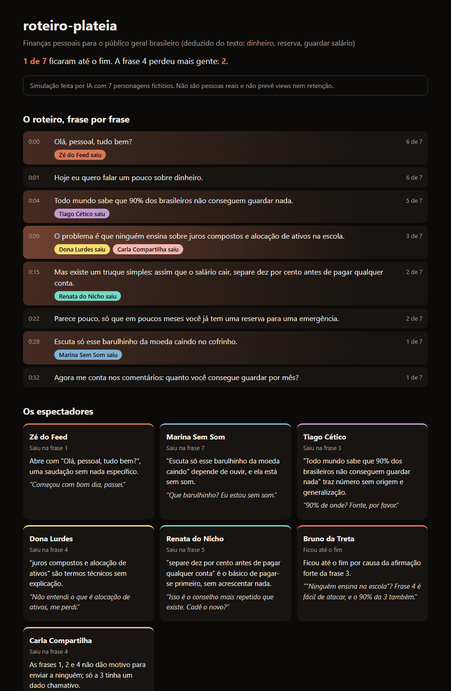

<div align="center">


<a href="https://sparks-gamesstudio.github.io/fabrica-de-canais/"></a>

**Sete espectadores fictícios leem o seu roteiro e dizem em qual frase iriam embora, por quê e o que comentariam.**

<p>
  
  
  
  
</p>

<p>
  <a href="#instalacao"></a>
  <a href="https://sparks-gamesstudio.github.io/fabrica-de-canais/github.html"></a>
  
</p>

</div>

## 👋 O Rebite explica


> Depois de escrever um roteiro, você já não consegue enxergar os defeitos dele. Eu chamo uma plateia inventada para reclamar por você, ainda antes de gravar. Ela não prevê o sucesso do vídeo, mas aponta frases para você olhar de novo.

<br clear="right" />

## 🍿 A plateia

| Espectador | Vai embora quando |
|---|---|
| **Zé do Feed** | A abertura enrola |
| **Marina Sem Som** | A frase depende do áudio ou não cabe em uma legenda |
| **Tiago Cético** | Aparece número sem origem ou promessa exagerada |
| **Dona Lurdes** | Surge um termo técnico sem explicação |
| **Renata do Nicho** | O vídeo repete o básico ou erra um detalhe |
| **Bruno da Treta** | O vídeo fica morno, e o comentário dele mostra a frase mais fácil de atacar |
| **Carla Compartilha** | Ela não imagina para quem enviaria |

Quer outro perfil? As fichas ficam em `espectadores.md`, e os nomes e cores em `scripts/plateia.py`.

## 🗺️ O que você recebe



Um mapa em HTML ([exemplo](exemplos/mapa-exemplo.html)) que abre no navegador, com:

- o roteiro frase por frase, mais quente onde a plateia saiu;
- quantos espectadores ainda estão presentes em cada ponto;
- o motivo e o comentário de cada espectador;
- até 3 consertos, do mais importante para o menos importante.

<a id="instalacao"></a>

## ⬇️ Como instalar

Precisa do [Claude Code](https://claude.com/claude-code) e do Python 3.10 ou mais novo. Não há pacotes para instalar.

```bash
git clone https://github.com/sparks-gamesstudio/plateia-falsa.git $HOME/.claude/skills/plateia-falsa
```

Depois, em uma sessão nova do Claude Code, peça:

```text
/plateia-falsa testa o roteiro do arquivo meu-roteiro.txt
```

Para testar sem um roteiro seu, use o `exemplos/roteiro.txt`, que tem defeitos de propósito.

<table>
<tr>
<td width="110"></td>
<td>

**Aviso honesto:** é uma simulação feita por IA, com personagens inventados. Não são pessoas reais, não mede retenção e não prevê views. Duas rodadas podem dar respostas diferentes. Use para achar frases fracas e decida com a sua cabeça.

</td>
</tr>
</table>

## 🔒 Seus dados

O mapa é gerado no seu computador e não usa rede. O roteiro passa pelo Claude Code, como qualquer texto que você envia a ele.

## 🧪 Para quem quer mexer

```bash
python -m unittest discover -s tests -v
```

---

<div align="center">

<a href="https://sparks-gamesstudio.github.io/fabrica-de-canais/"></a>

Feito pela **[Fábrica de Canais](https://sparks-gamesstudio.github.io/fabrica-de-canais/)**, skills de Claude Code para canais de vídeo no piloto automático.

<a href="https://instagram.com/afabricadecanais"></a>
<a href="https://github.com/sparks-gamesstudio"></a>

<sub>Licença MIT · use, modifique e compartilhe. Se ajudou, deixa uma ⭐</sub>


</div>
